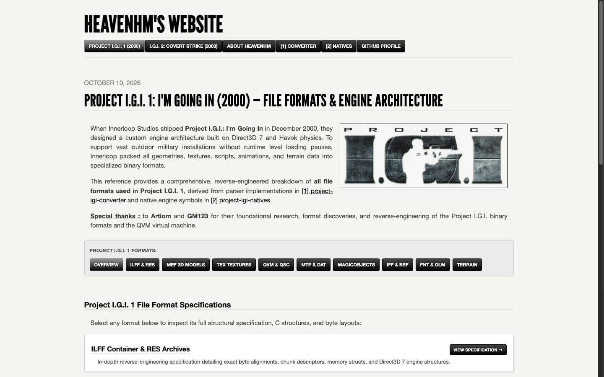

# IGI-Research-Data

IGI-Research-Data 🕵️‍♂️ is a repository that contains all the research information for [Project I.G.I](https://en.wikipedia.org/wiki/Project_I.G.I.) game for educational purposes.

## 🌐 Newly Released Web Portal

We are thrilled to announce the official launch of the newly released [**Project I.G.I. Research Portal**](https://project-igi-research.vercel.app/)! This live web application serves as the complete interactive reference and digital archive for both **Project I.G.I. 1 (2000)** and **I.G.I. 2: Covert Strike (2003)** binary file formats, engine architecture, and reverse-engineered documentation, directly linked with our suite of open-source tools and converters.

  

## Data - Section

### `Data` section contains all the data that were used for Game Level/A.I/3D-Objects/Graphs etc.

- `Data/AI` - Contains data scripts regarding A.I behaviors and Actions used in the level like `level/AI/503.qvm`.
- `Data/Graphs` - Contains data regarding Graphs of the game like `Areas` information and Graph _Nodes, Vertices, Material_ information stored. It also contains some graphs converted to [SVG](https://en.wikipedia.org/wiki/Scalable_Vector_Graphics) format.
- `Data/Misc` - The Misc section contains information about Game variables/constants used in the IGI Game engine, and a fully advanced [Cheat-Engine Table](https://en.wikipedia.org/wiki/Cheat_Engine) 🕹️ _PROJECT-IGI-1.CT_ which has data for Player/A.I/Vehicles/Game State/Profile and more.

## Research - Section

### `Research` section contains technical specifications for Project I.G.I standard game file formats.

| Format | Extension | What's Included | Path |
| :--- | :--- | :--- | :--- |
| **DAT** | `.dat` | Level asset lookup tables and model-to-texture ID mappings | `Research/DAT` |
| **FNT** | `.fnt` | In-game bitmap font format, glyph metrics, and character atlas mapping | `Research/FNT` |
| **IFF** | `.iff` | Skeletal animation container and REIH bone hierarchy chunks (31/47 bones) | `Research/IFF` |
| **ILFF** | Container | Innerloop shared binary container header (20-byte) and chunk architecture | `Research/ILFF` |
| **MEF** | `.mef` | 3D mesh & model format, vertex buffers, polygon indices, UVs, and materials | `Research/MEF` |
| **MTP** | `.mtp` | Terrain heightfield elevation grids, tiles, textures, and object placements | `Research/MTP` |
| **PIC** | `.pic` | Innerloop picture graphic format and uncompressed tile data | `Research/TEX` |
| **QSC** | `.qsc` | Human-readable Q-Script source code and mission script syntax | `Research/QSC` |
| **QVM** | `.qvm` | Virtual machine compiled bytecode, instruction sets, and header structures | `Research/QVM` |
| **RES** | `.res` | Resource archive container (ILFF IRES) bundling models, textures, and scripts | `Research/RES` |
| **SPR** | `.spr` | In-game sprite graphic format and tile structures | `Research/TEX` |
| **TEX** | `.tex` | LOOP 2/7/9/11 uncompressed texture format, mipmaps, and color palettes | `Research/TEX` |
| **WAV** | `.wav` | Audio format, Innerloop ILSF chunk headers, raw PCM and IMA ADPCM | `Research/WAV` |

## Tools - Section

### 🛠️ `Tools` section contains all the custom tools that were built for Project IGI 1/2 during research. 🛠️

| Tool Name         | Description                                                                                | Link                                                         |
| ----------------- | ------------------------------------------------------------------------------------------ | ------------------------------------------------------------ |
| 🌐 IGI Research   | Official web portal & interactive reference for IGI 1 and IGI 2 binary formats & engine.   | [Link](https://project-igi-research.vercel.app)             |
| 🧱 IGI Editor     | Professional 3D level editor for Project I.G.I 1 — build and edit missions in the browser. | [Link](https://project-igi-editor.vercel.app)                |
| 🎬 IGI Studio     | Mission builder with map computer, 3D close-up, *A.I* designer and built-in compiler.      | [Link](https://naumanhsa.github.io/project-igi-studio-site/) |
| 🎮 OpenIGI            | Open-source Project I.G.I, now ported to Windows, Linux and macOS — plus a browser edition that runs from your own copy of the game. | [Link](https://openigi.com)                     |
| 🔄 IGI Converter  | Convert and package all IGI assets — 2D/3D, binaries, models and more.                     | [Link](https://github.com/heaven-hm/project-igi-converter)   |
| 📜 IGI QVM Editor | Online QVM editor, compiler and decompiler for game scripts and binaries.                  | [Link](https://igi-qvm-editor.vercel.app)                    |

## Community Ports, Remasters, Mods and Patches

The following community projects complement the research and editing tools listed above. They are grouped by purpose rather than ranked by quality. Inclusion does **not** imply that a project was developed with generative AI, that all features have been independently tested, or that it is maintained by this repository.

| Project | Type | Description | Link |
| :--- | :--- | :--- | :--- |
| **OpenIGI** | Cross-platform reimplementation | Project I.G.I. reimplementation with Windows, Linux, macOS and browser editions; see the project for current build status. | [OpenIGI](https://openigi.com) |
| **Project IGI Editor (HeavenHM)** | 3D level editor | Browser-based level and mission editing for IGI 1. | [Editor](https://project-igi-editor.vercel.app) |
| **Project IGI Studio (NaumanHSA)** | Mission editor | Mission-building environment with map, AI and compilation tools. | [Studio](https://naumanhsa.github.io/project-igi-studio-site/) |
| **IGI Converter** | Asset conversion | Conversion and packaging utilities for IGI assets. | [Source](https://github.com/heaven-hm/project-igi-converter) |
| **IGI QVM Editor** | Script tooling | Browser-based QVM editing, compiling and decompiling. | [QVM Editor](https://igi-qvm-editor.vercel.app) |
| **Project I.G.I. PS Vita port** | Platform port | Community port requiring data from an original PC game copy; see release instructions for compatibility and status. **PS Vita, not PSP.** | [Release discussion](https://www.reddit.com/r/VitaPiracy/comments/1wwcwi0/release_project_igi_v01_data_files/) |
| **Neonix Remastered** | Visual/gameplay mod | Community remaster modifying the original game. | [Nexus Mods](https://www.nexusmods.com/projectigi/mods/5) |
| **IGI Patch (Blankname)** | Compatibility patch | Community fixes for running the original game on modern systems. | [IGIPatch](https://github.com/BlanknameES/IGIPatch) |
| **IGI Research Portal** | Research documentation | Interactive reference for game formats and reverse-engineering findings. | [Research Portal](https://project-igi-research.vercel.app/) |

> **Development-method note:** AI assistance should be attributed to a specific project only where its maintainers document that use. The above table is a community resource index, not a list of confirmed AI-built projects.

## Templates - Section

### `Templates` section contains templates for [010 Editor](https://www.sweetscape.com/010editor/) for both IGI1 and IGI2 game.

## Data Disclaimer

This data is for educational purposes to learn how the game reacts with [Game Engine](https://en.wikipedia.org/wiki/Game_engine) and to understand game mechanics behind `QVM` Virtual machine and all its stuff. Please don't use this data to make `cheats/hacks` for this game, as this data was originally used by Game developers to develop the game. So, respect the developers and don't ruin any data posted here.

Some data were decompiled using the original game `igi.exe` using [IDA](https://hex-rays.com/ida-pro/)/[Ghidra](https://ghidra-sre.org/) for educational purposes, not intending any harm to game files and their property.

## Credits and People

If you want to use this data, respect fellow researchers and give proper credits to people. (давать людям должные кредиты)

- [Yoejin Light](https://vk.com/id436486682) 🌟 : _MTP, Models structure_ and information.
- [Dimon Krevedko](https://vk.com/dimonkrevedko) 🌟 : **Graphs and Nodes** structure and information.
- [Artiom Rotari](https://github.com/NEWME0) 🌟 : _DConv Tools for Decompiler_ and **Scripts**.
- [ORWA S](https://www.youtube.com/@totalwartimelapses6359) 🌟 - **Graphs Area and Nodes** compilation of information.
- [GM123](https://www.youtube.com/@gm1233) 🌟 - **Detailed Models Information**.
- **Dark** 🌟 - **Contrinuted on Various Projects and files (Resources,QVM,QSC etc) and UI/UX Designs**.
- [Ferit Coder](https://www.youtube.com/channel/UCpn_gZMkFVBUAe9SJK9hYQA) 🌟 - **Helped with IGI 2 Editor **Maps/Models** conversion to IGI 1.**.
- [HeavenHM](https://vk.com/id679925339) 🌟 - **Maintainer of this repo**.
- [Chat-GPT/ Claude](https://claude.ai) 🌟 - **Understanding complex game mechanics** with _Reverse Engineering_ and **Advaced Data Analysis** of Game files _QVM,QSC,.DAT and more_.

Copyright @2026 - HeavenHM.
